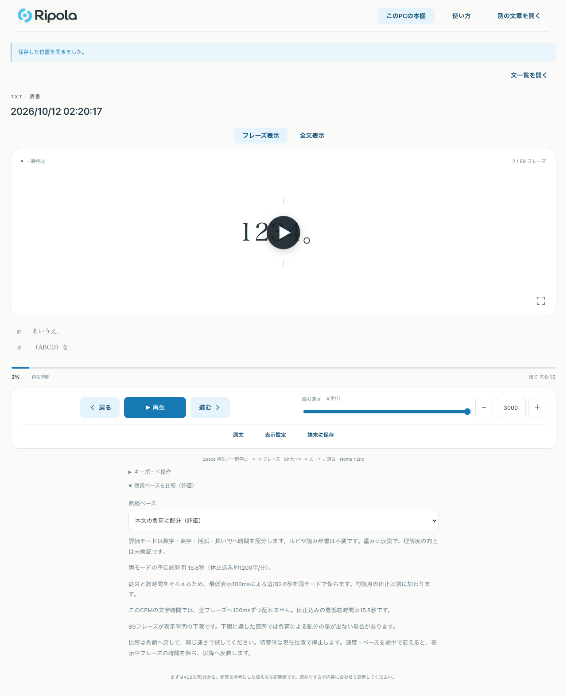

# 黙読ペース評価モードの検証記録

2026-10-12、foundation `5ba091044719baf26fd1f3cb5131bc04c6dc7b7b` を比較元として実施しました。[配分契約](reading-pace.md)に算術・保存・音声との境界を記載しています。

## UIの操作と画面

Playwrightで同じ自作本文を従来・評価モードに切り替え、600字/分の予定総時間が一致することを確認しました。再生・停止・再開、先頭への移動、原文seek、3000字/分での下限説明、明示保存と再読み込み、表示リセット後のペース保持を操作しています。

PCは1280px、狭い幅は390×844のChromiumエミュレーションです。両方で選択欄が44px以上、横溢れなしを検査し、次の画面を目視確認しました。狭い幅はスマホ実機の確認ではありません。

| PC | 390px幅 |
| --- | --- |
|  |  |

## 検査の条件

- Node 26.8.1、pnpm 12.3.4、`pnpm install --frozen-lockfile`。依存・lockfileの変更なし。
- 既存のChromium headless shell 1234を `PLAYWRIGHT_CHROMIUM_EXECUTABLE_PATH` で指定。Playwrightが既定で要求する1243は未導入です。
- `CI=1`、有料生成無効、専用のテストlibrary、workers 1。共有PCの負荷を受けるため、gitignoredの検証用configで起動240秒・expect/action 60秒・navigation 90秒・test 600秒を指定しました。通常の設定・製品の時計は変更していません。
- 音声は自作本文・合成トーンをMP3化したfixtureです。音響精度やTTS性能の測定ではありません。音声非干渉と縦書き音声の停止確認は60秒fixtureを使いました。追加時間を最後のcueへ配分し、6秒のseek先を保持します。他の既存ケースの既定12秒fixtureは維持しています。

## 結果と再確認した失敗

| 検査 | 結果 |
| --- | --- |
| `pnpm check` | 型・lint・265 unit tests（fail/skip 0）・local production build成功。 |
| Worker / Pages build | 成功。静的監査で `localGenerationApi=false`。 |
| 新規受入 | PC/390pxの黙読比較と音声非干渉、4件成功。 |
| 通常ブラウザ選別 | 22件の成功を複数実行で確認。preview 8件、dev/Pages残り12件、黙読評価の代表1件、縦書き音声の再確認1件。 |
| 登録・選別 | 全168件の登録照合、通常22件と残り15件の選別照合成功。168件全体の実行は未実施。 |

通常22件に評価モードの代表1件が含まれるため、新規4件を合わせた確認は25種類です。単一の22件実行で全成功したとは扱いません。有料UIの既存mockはdev RPC名を読むため、production previewで届かない2件をdevで再確認しました。

再生連打では、短いフレーズの表示時間を実UI操作が超えていました。保護される1000桁の数字fixtureにして、経過時間を保持したまま連打を確認しました。縦書き音声は短いfixtureが操作中に再生終了し、中央の再読ボタンが停止クリックを遮っていました。60秒fixtureへ変更した後の同じケースは成功しました。音声非干渉もchunk切替から離れて確認しています。製品の時計は変更していません。

共有負荷下でffmpeg/ffprobeの10秒起動確認により既存の圧縮再開1件が失敗しました。圧縮11件の単独再確認と、その後の全265件は成功しています。これらの操作時間や上流の測定値を、このPCの性能保証には使いません。

固定した最終base/head、検査ログ、PR URLは担当handoffへ記録します。理解度、TTS/ASR性能、実機スマホは未測定です。有料providerの実呼出し、新しい大容量model取得、デプロイは行っていません。
